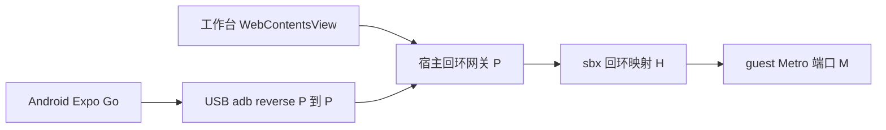

# Expo Android 第一阶段设计

第一阶段增加固定 Expo TypeScript 项目，复用工作台的代码修改与 Browser 能力，通过 USB 在 Android 真机预览，并在 macOS 宿主构建可独立安装运行的 APK。保留每空间一个 App，创建时在既有 Web 模板与 Expo 模板之间选择。

状态：设计待实施。2026-10-11，Asia/Shanghai。用户已选择 USB 优先；本轮授权仅为设计和实施计划，不包含源码修改、工具安装、设备操作、真实模型、sandbox live、构建或发布。实施顺序与验收见[实施计划](../plans/2026-10-11-expo-android-phase1.md)。

## 范围与取舍

| 项目 | 第一阶段决定 | 理由和完成边界 |
| --- | --- | --- |
| 生成工程 | 新增版本化 `expo-android` 固定模板；Expo、React Native、React Native Web、TypeScript | 一个代码起点覆盖 Web 快速预览和 Android 原生运行；不转换已有 Web 项目 |
| 宿主平台 | 延续 macOS Apple Silicon；Android 真机以 ARM64 为首个受支持 ABI | 与现有产品验证平台一致；Windows、Linux 宿主和其他 ABI 不在本阶段 |
| 工作台预览 | 现有 WebContentsView 加载 Expo Web，标明“Web 预览” | 保留网页观察、截图和任务入口；不代表 Android 原生画面 |
| 真机预览 | USB、指定设备的 adb reverse、匹配模板 SDK 的 Expo Go | 用户已确认 USB 优先；不增加无线配对、LAN 服务或公网隧道 |
| 安装包 | macOS 本地工具链生成 ARM64 release APK，独立测试签名 | 不上传项目到 EAS，不要求 Expo 云账号；APK 供本地安装测试，非商店发布 |
| 依赖与配置 | 固定依赖及可执行配置；允许修改应用源码、资源和有限的声明式 App 配置 | 第一阶段有可验证的 Expo Go 和宿主构建边界；不支持任意原生模块、config plugin 或工程导入 |
| 数据与业务 | 固定样例为离线清单，使用已验证的本地持久化依赖 | 不引入 Hono/PGlite 后端；Web 和手机数据各自保存，不承诺跨端同步 |
| 导出语义 | “导出源码”保留；新增“导出 Android APK” | 源码目录与安装包分别记录，构建完成、设备验收和用户接受分别显示 |

本设计扩展移动端产品规划；[比赛计划的排除项](../plans/2026-10-os2026-task-plan.md)仍适用于原比赛固定验收，不把移动端设计或未来通过记为 C1–C3 已完成。iOS、AAB、商店上传、云构建、模拟器内嵌、原生元素点选、自动安装 APK 和任意依赖扩展留到后续阶段。

## 当前实现与新增落点

读取基线：`JadeSnow7/web-studio-lab`，HEAD `cf62dc74f49e7f9e81598be7b9e5109cf5946e9c` 加当前未提交内容。现有源码文件与未跟踪文件均保留；以下是静态接线事实，不是本轮运行结果。

| 现有入口 | 当前事实 | 本阶段改动责任 |
| --- | --- | --- |
| [workspace 协议](../../packages/protocol/src/workspace.ts)、[managed-app 协议](../../packages/protocol/src/managed-app.ts) | `createApp` 无模板参数；ManagedApp 无模板类型；源码包最多 256 文件 | 模板身份、具名设备和构建命令、结果 DTO |
| [WorkbenchApplication](../../apps/desktop/src/main/workbench/application.ts) | 单空间一个 App；Main 持有业务状态；应用命令有内存串行与去重 | 保持唯一业务写入者，增加设备租约、构建记录及冻结阶段的操作门槛 |
| [WorkbenchHost](../../apps/desktop/src/main/workbench/host.ts)、[ports](../../apps/desktop/src/main/workbench/ports.ts) | 固定读取 standard-app；只接受受管回环 URL；源码导出写目录和 manifest | 两个明确模板分支、回环网关与本地能力装配；不建设通用插件框架 |
| [AppService](../../apps/service/src/app-service.ts)、[app-helper](../../apps/service/src/app-helper.py) | Web 专用迁移与构建；固定健康检查；sbx 只发布宿主回环端口 | Expo 运行适配、受管 Metro、停止事实、源码快照读取 |
| [repository](../../apps/desktop/src/main/workbench/repository.ts) | 工作台 schema 3；service App registry 独立为 version 1 | 预定迁移至工作台 4 / App registry 2；实施前重核当前版本 |
| [ManagedAppDialog](../../apps/desktop/src/renderer/src/workspace/ManagedAppDialog.tsx)、[Browser](../../apps/desktop/src/renderer/src/workspace/Browser.tsx) | 创建、启动、停止、源码导出与网页展示 | 模板选择、Web 预览尺寸、USB 连接、APK 构建进度与结果 |

当前应用操作锁没有覆盖所有 Agent、终端和外部写入。不能用它宣称项目已经具备全局原子快照。当前源码包为 8 MiB 总量、256 文件，并受协议单文件 base64 上限约束；模板必须满足这些边界，APK 和原生生成目录不经过这条 DTO。

## 状态所有权与公开契约

业务继续由 Main `WorkbenchApplication` 归并和持久化，service 只报告进程、传输、设备和产物事实，renderer 保存表单、选中设备及尺寸等展示状态。`runId` 仍专指 AI 任务执行；移动端构建用 `buildId`，设备连接用 `deviceSessionId`。

| 对象 | 必要字段与约束 |
| --- | --- |
| 项目描述 | 原 workspaceId/projectId/guestCwd 加 templateId、templateVersion、templateHash、androidPackage；包名创建时生成并固定，例如 `com.webstudiolab.generated.p<无连字符项目UUID>` |
| App 运行实例 | 原 appInstanceId 加 previewKind、guest Metro 端口、sbx 映射回执、宿主网关端口、实例代次；状态仍为 created/starting/running/stopping/stopped/failed |
| 设备会话 | deviceSessionId、projectId、appInstanceId、实例代次、设备 serial、reverse 两端端口、映射创建回执、状态与 cleanupConfirmed；设备 serial 只用于本机执行，交付证据脱敏 |
| 源码快照 | snapshotId、project/template 身份、按相对路径排序的文件散列和字节数、sourceSha256、配置摘要、createdAt；不可变快照和可写构建目录分开 |
| 构建记录 | buildId、commandId、snapshotId/sourceSha256、toolchainFingerprint、builderTemplateHash、androidPackage、versionName/versionCode、阶段、失败原因、cleanupConfirmed |
| APK 产物 | artifactId、buildId、相对受管目录位置、字节数、SHA256、ABI、minSdk、证书 SHA256、验证状态；无私钥、密码、完整环境或源码正文 |

拟新增或调整的具名接口如下，最终 schema 与类型放入 `packages/protocol`，能力端口放入现有 `WorkbenchRuntime`。不暴露任意命令、路径、ADB 参数或代理目标给 renderer。

| 命令或查询 | 输入及效果 |
| --- | --- |
| `createApp` | 原身份/commandId 加 templateId；Main 从可信模板目录确定版本和内容。新客户端必须显式选择类型，旧数据通过持久迁移处理，不增加模糊默认分支 |
| `startApp` / `stopApp` | 按项目类型调用明确适配器；停止 Expo 同时撤销该实例的预览和设备租约 |
| `listAndroidDevices` | 返回在线、未授权、离线设备及可用性；不安装软件，不改变手机权限 |
| `connectAndroidDevice` / `disconnectAndroidDevice` | 固定 workspace/project/appInstance/generation 和选择的 serial；只操作该设备本次拥有的映射 |
| `buildAndroidApk` / `cancelAndroidBuild` | 固定项目及源码冻结请求 / buildId；Main 持久记录阶段并协调停止、快照、构建、签名 |
| `exportAndroidApk` | 只选择已完成 artifactId；Main 弹出保存对话框，按校验和复制文件并附 manifest；取消保存不删除已完成产物 |
| `exportApp` | 继续导出实际源码，不自动变成 APK，也不修改项目或自动启动 |

命令去重以 commandId 和载荷指纹为准。同 ID 不同载荷拒绝。已持久受理的构建重试返回同 buildId；崩溃恢复先查询事实，不再执行一次构建、签名或 versionCode 分配。长耗时 I/O 在 Main 元数据队列之外；回执按项目、操作及实例代次归并，切空间不改变目标。

旧项目迁移为确定的 standard-app 模板身份，不能默认变成 Expo。保留旧存储备份，未知较新版本拒绝覆盖。活动设备、进程和网关句柄不恢复；非终态构建标为 interrupted/待核对。私钥丢失不自动生成替代密钥。

## Expo 工程创建

新增 `templates/expo-android`，有独立 lockfile、模板版本和内容散列。创建时复制包内经过校验的模板到该项目 guest cwd；不执行 `create-expo-app@latest`。创建只建立工程与身份，依赖准备发生在启动或构建的明确阶段；缺包或网络失败原样报告，不替换包管理器或 SDK。

固定依赖包含 Expo、配套 React/React Native、react-native-web、react-dom、Metro Web runtime、TypeScript，以及同时通过 Web/Expo Go/APK 验证的本地存储库。以简单 `App.tsx` 为入口，不引入 Expo Router、服务端路由、原生插件或 development client。精确 SDK/CLI/Go/Node/包管理器版本在实施包 P0 实测后写入工具链清单；创建使用清单和锁文件，不运行时解析“最新”。

允许变更的是 `App.tsx`、`src/` 中应用代码及测试、`assets/` 中明确支持的图片/字体等数据，以及声明式 `app.json` 的 name、version、图标和启动图字段。图标只引用快照内资源；包名与 Main 项目身份一致，versionCode 由构建用例分配。样例业务包括输入清单项、完成切换、删除和冷启动后保留数据。

`package.json`、lockfile、入口注册文件、Metro/Babel/TS 配置及可信构建辅助文件按模板散列固定。第一阶段不支持用户提供的 `app.config.js/ts`、config plugins、`android/ios` 原生工程、npm 生命周期脚本和任意新增依赖。发现这些变更时启动/构建显示具体超范围路径，用户仍可导出实际源码；不能忽略改动后导出看似成功的另一个应用。模板说明及给 Agent 的项目约束写明可编辑范围。

新增模板随 Electron 包分发，固定清单单独登记；不能误用 standard-app 的 Linux 依赖归档。第一阶段依赖可以按锁文件在线准备，不承诺首次离线安装；是否为 Expo 增加独立离线载荷另行决定，不改变现有 Web 模板离线载荷。

## 工作台 Web 预览

Metro 在 guest 内运行。宿主建立只绑定 `127.0.0.1` 的受管网关，用稳定的本次实例端口解决 sbx 发布端口在启动后才确定的问题。网关只是一个实例到一个经核实 upstream 的 HTTP/WebSocket 转发器，不接受请求传入的代理地址。



启动顺序：

1. Main 固定项目和新的 appInstanceId；service 核验模板、配置与锁文件，按锁文件准备 guest 依赖并执行类型检查。
2. 本地适配器先占有随机回环端口 P，但在 upstream 核验前只返回“准备中”，Main 不授予可用 Browser lease。
3. guest 可信启动器选定并核对端口 M，启动锁定的 Expo CLI，语义为 `expo start --go --host lan --port M`；advertised URL 用 `EXPO_PACKAGER_PROXY_URL=http://127.0.0.1:P`。这里只允许 guest 网络监听，不在宿主开放 LAN。端口被抢占时明确失败，不交互选择其他端口。
4. 复用 sbx 发布取得回环 H；确认 M 属于本次 guest 进程，核验 Expo manifest、Web 响应及模板/项目摘要，再将网关 P 的 upstream 固定为 H。可信回执来自适配器，不信任应用 stdout 中伪造的 ready 文本。
5. Main 创建或复用该项目的 Web 资源，授予精确实例/origin lease，加载 `http://127.0.0.1:P`。原页面拿不到 preload 或工作台 IPC。

`EXPO_PACKAGER_PROXY_URL` 是官方提供的覆盖入口，但 manifest、bundle、图片、source map、HMR WebSocket 和错误覆盖层能否全部贯通仍是 P0 实验门槛。不得凭终端打印 URL 判定通过；不得默默退回公网隧道。相关 API 依据见 [Expo CLI](https://docs.expo.dev/more/expo-cli/)，实现参数以锁定版本实测冻结。

Browser 工具栏增加 390 × 844、412 × 915 和自适应三个展示尺寸，使用已有 Main 布局接口调整内容区域；显示“Web 预览，原生效果请在 Android 设备查看”。这些尺寸用于布局验证，不模拟 Android 系统、字体或安全区。点选和截图仍为同页 Web 现场，保留原任务、项目、实例代次约束。

应用源码修改触发 Fast Refresh；类型检查失败、Metro 编译错误、进程退出分别显示，不把上一帧截图当新版本预览。模板里的稳定 `testID` 用于固定样例验收；DOM 元素定位不能承诺映射到唯一 React Native 源组件。原生元素点选不属于第一阶段。[Expo Web 支持](https://docs.expo.dev/workflow/web/)

## Android USB 真机连接

前置条件为可用的本地 adb、手机开启 USB 调试并由用户在手机确认 RSA 授权、匹配模板 SDK 的官方 Expo Go。工具仅检查并提供明确安装入口，不自动勾选许可、安装软件或修改设备权限。手机 API/ABI 不满足模板时直接显示不支持。

USB 使用 RN 官方建议的 [adb reverse](https://reactnative.dev/docs/running-on-device)。由本地适配器在已选择设备执行固定命令，示意如下；serial 与端口是经协议/设备清单校验的参数，通过 argv 传递，不拼接 shell：

```text
adb devices -l
adb -s <serial> reverse --list
adb -s <serial> reverse --no-rebind tcp:<P> tcp:<P>
adb -s <serial> shell am start -a android.intent.action.VIEW -d exp://127.0.0.1:<P> -p <已验证的ExpoGo包名>
```

同一端口 P 在宿主网关与设备端使用，保证 manifest 内的绝对地址、WebSocket 地址和打开链接一致。设备 P 已有未知映射时拒绝连接，不覆盖或接管；用户可断开原连接，或明确停止并重启本项目以获得新 P。`--no-rebind`、intent 参数及 Expo Go 包标识必须由 P0 对实际 adb/Go 版本验证后冻结。

只支持一项目一次连接一台设备；多设备时必须选择，不自动挑第一台。列表状态为 unavailable/unauthorized/offline/available；会话状态为 connecting/transportReady/openRequested/disconnecting/disconnected/failed。`transportReady` 只证明 adb 与映射成立，`openRequested` 只证明已发出打开请求，不显示成“手机页面验证通过”。真机显示和交互通过另有验收记录。

记录设备 serial、映射前状态、精确规则、操作和 App 实例身份。正常断开只删除自己创建且仍匹配的规则；不执行 `adb kill-server`、`reverse --remove-all`，不关闭 Expo Go 或卸载其他 App。停止预览先撤销网关和 Browser lease，再核对设备规则及 sbx/guest 进程清理。拔线时无法确认删除则保留 cleanupPending；重新发现同一设备后复核，不自动恢复预览，不把新设备的端口当旧规则。

映射元组本身不能抵抗外部工具删除再建立完全相同规则的情况；本阶段设备连接期间不支持其他工具同时管理同设备同端口，不能声称强隔离。检测到不同规则或身份变化时停止清理并报告冲突。设备回到无规则状态且旧网关、sbx 端口及所属进程均已停止，才记 cleanupConfirmed。

Expo Go 版本与模板一起验证。版本不匹配时提示官方兼容版本入口，不自动升级工程或替换手机 App；Android 官方历史安装包可用于已固定 SDK。[Expo SDK 升级与 Expo Go 版本](https://docs.expo.dev/workflow/upgrading-expo-sdk-walkthrough/)

## APK 构建与导出

### 工具链与执行位置

选择 macOS 宿主的固定 Android SDK/JDK/Gradle 工具链，不将 Linux ARM64 guest 假定为可用 Android builder。[Android 官方平台要求](https://developer.android.com/studio/install)提供 Mac ARM 工具链依据；实际 Expo、SDK Build Tools、NDK/CMake、JDK、Gradle、Node 组合必须通过 P0，未安装或不匹配时 `toolchain_unavailable`。

本地执行通过 Electron 无关的 service 适配器实现，由 Main 装配受管目录和工具位置。用户点击 APK 导出时界面说明会在本机准备依赖并构建；首次下载需要网络，工具安装另有明确操作。这里没有新增 EAS 账号、源码上传或后台调度。受管目录不是 OS 沙箱，固定模板和输入边界也不等于任意不可信代码隔离。

### 源码冻结和可信构建目录

1. 受理 buildId，阻止本项目新的 Lab AI 写入运行与应用操作；存在运行中的 Agent 时拒绝并提示先完成或取消，不替用户丢弃修改。告知并停止当前 Web/USB 预览，等待实际清理确认。
2. 固定 templateHash 和声明式配置。检查受管项目所有参与构建的文件、路径与预算，拒绝符号链接、非普通文件、路径逃逸、大小写/Unicode 规范化后碰撞、未支持的可执行配置、嵌套 `package.json`/Babel 配置及 native 工程覆盖。
3. 读取完整纳入范围的文件清单和散列，再捕获字节并再次核对原目录清单/散列。捕获字节与两次清单不一致则 `source_changed`，不开始宿主构建。终端或外部工具仍可能写文件，该检测不是恶意并发下的原子锁；验收要求捕获窗口内暂停外部编辑。
4. 将捕获到的字节和 canonical manifest 保存为独占创建的 snapshotId；sourceSha256 包含所有实际应用源码、资源、配置和锁定模板身份。随后构建只读该快照；每次使用前复核散列。后续 guest 变化不改变这次输入，产物显示对应快照。
5. 在独立 buildId 目录从可信模板重建工程，只导入允许的应用源码/assets 和经 schema 校验的数据字段。受保护配置一旦与模板不同必须拒绝，不能静默替换后成功。生成 `android/`、依赖和产物只留在构建目录，不回写 guest。

依赖、Metro/Babel 配置、Prebuild plugins 和 Gradle 都可能执行代码，故不在宿主直接运行 guest 的 package scripts 或配置。Android 包名、versionCode 由可信构建上下文生成；`app.json` 只接受列明字段，不通过字符串查找或 JavaScript 求值获取配置。[Expo config plugins 执行机制](https://docs.expo.dev/config-plugins/introduction/)

### 构建和签名顺序

固定构建配方为：从锁文件安装宿主依赖（默认禁用生命周期脚本，必需步骤由 P0 审计并固化）→ 类型检查 → 锁定 Expo CLI `prebuild --platform android --no-install` → 可信 Gradle 配方 `:app:assembleRelease --no-daemon` → 校验 unsigned APK → zipalign → 单独签名 → 验证 → 原子发布产物和 manifest。调用本地锁定二进制，不使用会临时下载未知版本的 npx。

可信原生生成/Gradle 配方明确关闭默认 debug signing，产出 unsigned release APK；不能依赖生成模板的默认签名行为。release 必须嵌入 JS 和资源、关闭 debuggable、不含 expo-dev-client、不依赖 Metro、禁用本阶段未实现的 OTA 更新。只支持冻结的 ARM64 ABI；所需 minSdk 与设备矩阵在 P0 固定。[Expo 本地发布构建](https://docs.expo.dev/guides/local-app-production/)、[APK 与 AAB](https://docs.expo.dev/build-reference/apk/)

每个项目第一次签名建立稳定的本地测试密钥；密钥保存在独立受管签名目录，密码由系统 Keychain 保存。构建与签名分进程，构建子进程不传入密钥路径、密码或密码环境变量；签名器只接收核验过的 APK 与项目 keyRef，通过安全输入读取凭据。相同用户权限并不构成 OS 隔离，因此仍依赖前述可信构建输入边界。普通日志、renderer、Agent 上下文及源码导出均不包含秘密。

签名前 zipalign，签名后不再改 APK；用 `apksigner verify --verbose --print-certs` 核验并记录公钥证书摘要。包名和签名身份固定，versionCode 在 Main 持久化时单调分配，失败允许留空号，不回退重用。密钥丢失或指纹不符时失败；不自动换密钥，不自动卸载手机现有应用。[Android 签名工具](https://developer.android.com/tools/apksigner)

成功产物保存于本机受管 artifacts 目录，manifest 绑定 snapshot、toolchain、配方、APK SHA256、证书摘要和版本。APK 不进入 8 MiB 源码协议，renderer 只拿摘要；导出经保存对话框复制并复核 SHA256。只有 APK 验签和身份检查通过才显示“APK 已生成”；“真机离线验收通过”和“用户接受”分别记录。

第一阶段不承诺重新构建得到字节相同 APK；可复验的是输入、工具链、构建配方、签名身份和业务结果，APK 文件散列标识实际产物。测试签名密钥不会随源码导出，未实现安全备份前只承诺在保有该密钥的本设备上连续升级。

### 取消和恢复

构建阶段为 preparing/snapshotting/installing/prebuilding/building/signing/verifying/succeeded；失败为 failed，取消经 cancelling 到 cancelled，重启未确认则 interrupted。cleanupConfirmed 独立于终态。取消关闭新阶段入口，停止本次所属进程组及 Gradle 子进程，确认后释放项目操作门槛；不杀其他 Android Studio/Gradle 进程。禁止共享构建守护进程，Gradle user home/工作目录按受管构建隔离。

签名或导出中断只留下临时文件，不发布“成功 APK”；已原子发布的历史产物不受新构建失败影响。用户关闭对话框不取消，切空间不改变任务，应用退出走既有清理流程，不把构建留为隐式后台任务。重启后先核对记录、目录与进程身份，保留失败证据，不自动继续安装、签名、连接设备或再次构建。

## 用户操作与验收场景

“新建 App”保留现有入口，增加 Web 与 Expo Android 两个选择；创建后类型不可切换。Expo 管理区提供“启动 Web 预览”“连接 Android USB”“停止预览”“导出源码”“导出 Android APK”。未配置 adb/SDK 时分别显示原因，创建和 Web 预览不因没有 Android 工具而被禁用。

APK 操作开始前显示将停止预览并构建当前源码；构建时展示实际阶段、取消和错误。错误后可定位到缺少的工具、未授权设备、配置文件、编译诊断或未确认清理事实，不以统一“启动失败”掩盖不同问题。完成后展示版本、快照摘要和保存入口。

代表性走查：用户在空空间选择 Expo，创建离线清单并启动 Web；连接自己的 USB 手机，在 Expo Go 看到清单和本地图片；通过原会话把新增项按钮文字改成“加入清单”，Web 和手机均热更新。停止预览并构建 APK，安装后停止所有开发服务、移除 reverse、拔线、断网，手机冷启动仍显示新文字，可以增删并保留清单。再次修改和导出，使用同包名、同证书、更高 versionCode 覆盖安装，原数据保留。每个结果都绑定实际源码和产物，不能由 Web 成功代替手机结果。

## 设计成立条件

本方案的产品路线已确定；P0 仍需证实两项适配事实：固定 Expo 版本通过 guest → 回环网关 → USB 的全部资源/HMR 链路，以及受限模板在 macOS ARM64 上生成独立 release APK。任一失败则停止依赖它的实施包，记录具体原因并修改对应设计；不临时增加 EAS、公网隧道或任意宿主执行作为兜底。

本轮只做静态源码核对和官方资料核查。所有移动端创建、预览、设备连接、构建、签名与离线运行验收当前均为 `not_run`，不能作为已实现能力。
