# 多 Harness 协作设计（Multi-Harness Collaboration）

让 Web Studio Lab 在同一业务权威下接入多种 Agent Harness（Codex、Claude Code、Gemini CLI、Cursor、Devin 等），支持多个 Agent 在隔离副本上并行执行、按用户自己的账号分别运行，用 Bot 角色组织协作与会议，并提供一套跨 Agent 的上下文交换机制。

状态：**已采纳 v0.2，2026-10-21（Asia/Shanghai）**，按[实施计划](../plans/2026-10-21-multi-harness-collaboration.md)分工作包实施。用户已于 2026-10-21 决定 D1、D6、D7（见 §12），其余待决事项按建议执行，除非另有决定。决策摘要见 [ADR-0003](../architecture/adr/0003-pluggable-harness-and-collaboration.md)，工作包与验收见实施计划。[AGENTS.md](../../AGENTS.md) 中原“订阅、多 Agent 不在首版范围”的约定已按本设计修改（W1）。

## 0. 目标与非目标

目标：

1. **多 Harness**：一个 `AgentHarness` 端口，多种适配器；同一任务可以选择不同 Harness 执行，记录可直接对比。
2. **多账号（Profile）**：每个 Harness 可配置多个 Profile，对应用户本人在该 CLI 上的不同登录；Lab 只选择用哪个 Profile 启动，不经手凭据。
3. **并行**：同一项目可同时有多个写入执行，每个执行在自己的隔离副本（Lane）上写入；主工作树只接受合并。
4. **Bot 与会议**：Bot 是持久的角色定义；会议是有议程、轮次上限和固定产出格式的多 Agent 会话。
5. **跨 Agent 上下文**：Context Board 与 Handoff 包，经 MCP 提供给所有 Harness；内容一律按不可信数据处理。

非目标（本设计不做，后续另立合同）：

- 同一服务商的多个账号自动轮换以绕开限额；一个订阅给多人共用；把登录态代理给其他工具。
- Agent 之间不经 Lab 的直接通信。
- 行级自动合并；冲突一律交用户裁决。
- 云端托管运行环境与生成 App 部署（仍按 2026-10-16 计划 B3 另立 SPEC）。
- 实时多人协作、好友、云账号。

## 1. 读取基线与现有耦合点

读取基线：`JadeSnow7/web-studio-lab` `origin/main` = `c4ad991c285ca2863c3b6ef69fd04af02e268dce`（2026-10-21 20:28，PR #14 合并）。以下为静态读取事实，未运行任何检查。用户本机 checkout 的 `origin/main` 跟踪引用停在 `b5531e1`，实施前须先 fetch 并以届时的最新 `origin/main` 重新核对本表。

| 耦合点 | 位置 | 现状 | 本设计的处理 |
| --- | --- | --- | --- |
| Harness 名称写死 | `packages/protocol/src/run.ts:116`、`packages/protocol/src/execution.ts:5`、`apps/desktop/src/main/execution.ts:8` | `z.literal('Codex CLI')` | 改为 `HarnessRef`（见 §4.2），旧记录迁移为 `{ harnessId: 'codex', adapter: 'native' }` |
| 界面标签写死 | `Session.tsx:416`、`ChatMessages.tsx:43`、`RunDetails.tsx:54`、`ConversationsPage.tsx:79` | 助手消息固定显示“Codex CLI” | 显示该会话或执行实际绑定的 Harness/Bot 名称 |
| 参数构造与事件解析 | `apps/service/src/codex-chat.ts:320-323`、`parseCodexLine`（:47） | `codex exec --sandbox workspace-write [resume <threadId>] --json`；解析 Codex JSONL | 迁入 `harness/codex/`，行为不变，作为 native 回归基线 |
| MCP 注入 | `apps/service/src/guest-helper.py:285`、`:314-316` | 仅当 `argv[0] == "codex"` 时以 `-c mcp_servers.wsl_space.*` 注入 | 按适配器生成 MCP 配置；ACP 走 `session/new` 的 MCP 参数 |
| guest 工具版本 | `packages/protocol/src/setup.ts:81` | `codex: z.literal('0.160.0')` | 改为按已安装 Harness 列出版本，每项独立校验 |
| 会话执行入口 | `apps/desktop/src/main/workbench/ports.ts` `WorkbenchRuntime.send/cancel` | 以会话为粒度，内部直通 `ChatService` → `CodexChat` | `send` 增加冻结的 `HarnessBinding`；端口不再假定 Codex |
| 会话身份 | `ChatConversation.threadId`（`packages/protocol/src/chat.ts`） | 存 Codex thread | 改为不透明的 `harnessSessionRef`，由适配器解释 |
| 并发控制 | `application.ts:2023` | 只拒绝**同一会话**的第二个活动执行；同一项目的两个会话可同时执行并写入同一 guest 目录 | 这是 ARCHITECTURE §5“同项目统一写入控制”的现存缺口，W0 先补项目级写入许可，再开放并行 |
| 文件级三方合并 | `scripts/edu-source.mjs`（`snapshot/verify/merge/resolve`，见 [edu-source CLI](../development/edu-source-cli.md)） | 固定 edu-web 白名单；按文件字节三方选择，冲突输出 `conflicts.json` | 抽出与白名单无关的合并核心，供 Lane 合并复用；edu-web profile 保持不变 |
| 运行环境 | `apps/service/src/sbx.ts` `SbxConnection/GuestProcess` | Agent 与受管 App 只走 sbx guest；所有会话共享 `/home/agent/workspace` | 沿用；Lane 在 guest 内各用独立目录（§6） |

## 2. 总体结构

```mermaid
flowchart TB
    UI[Renderer：会话 / 任务 / 会议 / 看板] -->|具名命令| M
    subgraph M[Main WorkbenchApplication：唯一业务权威]
        AG[Agent 模块：Harness 注册表、Profile、Bot]
        SC[会话与上下文：Context Board、Handoff、会议记录]
        TE[任务与执行：TaskRun、Lane、写入许可、合并]
        VR[验证、结果与审阅]
    end
    M -->|HarnessBinding + 冻结 scope| S[Node 适配宿主 apps/service]
    S --> H1[native：Codex exec --json]
    S --> H2[acp：Claude / Gemini / Cursor / Devin CLI 等]
    S --> H3[pty-only：交互式 TUI，仅观察]
    S --> H4[remote：云端 Agent 会话]
    H1 & H2 -->|wsl_space MCP：观察、app.*、context.*| S
    S -->|执行事实、上下文写请求| M
```



原则沿用 ARCHITECTURE：Main 唯一写入业务事实；service 只承载适配器和所属进程；Agent 之间不直接通信，所有跨 Agent 内容经 Main 记录后再按冻结范围分发。

## 3. 概念与所有权

“Agent 模块”对应 2026-10-17 轻量模块化规划中的 Agent 模块；本表只划分职责，不要求为此新建空目录。

| 概念 / ID | 含义 | 所有者 | 必须区分 |
| --- | --- | --- | --- |
| HarnessDescriptor / `harnessId` | 一种已安装、自检通过的 Harness 及其能力声明 | Agent 模块（由适配器探测后报告） | 不是 Profile；同一 Harness 可有多个 Profile |
| Profile / `profileId` | 用户在某 Harness 上的一个登录，绑定到某个运行环境中的配置目录 | Agent 模块 | 只存配置目录引用和标签，不存任何凭据 |
| Bot / `botId` + `botVersion` | 持久角色定义：职责、默认 Harness 与 Profile、权限、可见上下文范围、预算 | Agent 模块 | Bot 不是运行；改动产生新版本，执行引用固定版本 |
| HarnessBinding | 一次执行冻结的 `harnessId`、版本、适配器类型、`profileId`、`botId@version`、`environmentId`、`laneId` | 任务与执行 | 创建后不随界面选择变化 |
| Lane / `laneId` | 一次写入执行专用的项目隔离副本，带基线 `sourceSnapshotId` | 任务与执行 | 不是 Workspace；主工作树也是一个特殊 Lane（`main`） |
| WriteLease | 对某个 `(projectId, laneId)` 的唯一写入许可 | 任务与执行 | 主工作树的许可只发给合并动作和串行兼容模式 |
| MergeRecord / `mergeId` | 一次 Lane → 主工作树的三方合并：base、lane、current 三个快照及结果 | 任务与执行 | 合并成功不等于验证通过或用户接受 |
| Board / `boardId` | 一个任务或一场会议的共享上下文空间 | 会话与上下文 | 一个 Board 只属于一个 Task 或 Meeting |
| ContextItem / `itemId` | Board 上不可修改的一条内容，带出处与引用 | 会话与上下文 | 作者身份由 Main 按冻结 scope 写入，不采信 Agent 自称 |
| Handoff | 一次执行结束时的结构化交接包，是一种 ContextItem | 会话与上下文 | 不是对话记录，不包含原始 transcript |
| Meeting / `meetingId` | 有议程、参与 Bot、轮次策略和固定产出的会话 | 会话与上下文 | 会议产出的任务草稿须用户确认后才成为 TaskVersion |

## 4. Harness 接入

### 4.1 四类适配器

| 类型 | 适用 | 事件来源 | Lab 能保证的 |
| --- | --- | --- | --- |
| `native` | Codex（现有路径） | Harness 自有结构化输出（Codex JSONL） | 现有全部合同；作为回归基线 |
| `acp` | 已在 [ACP registry](https://agentclientprotocol.com/registry) 列出的 Agent：Codex（适配器）、Claude Agent（Claude Code 的包装）、Gemini CLI、Cursor、Devin CLI、Grok Build 等 | ACP JSON-RPC：`session/update` 通知、`session/request_permission` 客户端请求 | 统一事件、权限请求进 Main 审批；Agent 使用客户端 `fs/*` 时写入经 Lab 控制 |
| `pty-only` | 只能交互使用的 TUI | 终端输出 | 只作为终端资源观察；不产生 TaskRun 执行事实，不进入验收 |
| `remote` | 会把会话交给云端继续执行的 Agent（如 Devin 的云端交接） | 对方回执与产出的补丁/分支 | 只记录回执；隔离等级 `remote`；代码离开运行环境须逐任务授权（§9） |

ACP 是首选通路：一个客户端适配器覆盖多数目标 Harness，避免为每个 CLI 写解析器。保留 Codex `native` 的理由是它已有 round-09/10/11 的真实验证，迁移期间作为对照。Claude Code 同时有 `-p --output-format stream-json` 的 native 路径；首选 ACP，native 仅在 ACP 包装器实测不满足取消或 MCP 要求时启用。

各 Harness 的具体参数、版本、MCP 注入方式和取消行为**一律在接入时实测**，不按文档假设。已知风险：Cursor 社区有 `-p` 模式下 MCP 工具未注入、进程无输出挂起的报告；ACP 的 `session/cancel` 是通知而非请求，不能据此判定进程已退出。

### 4.2 能力声明与引用

```ts
// packages/protocol 草案，字段名在 W1 定稿
HarnessDescriptor = {
  harnessId: string;            // 'codex' | 'claude-code' | 'gemini' | 'cursor' | 'devin' | ...
  displayName: string;
  adapter: 'native' | 'acp' | 'pty-only' | 'remote';
  version: string | null;       // 实测得到的 CLI 版本
  environmentId: string;        // 在哪个运行环境里探测到
  capabilities: {
    structuredEvents: boolean;
    mcp: boolean;               // 实测能调用 wsl_space 工具
    resume: boolean;
    permissionRequests: boolean;
    clientFs: boolean;          // ACP fs/* 由 Lab 提供
    clientTerminal: boolean;
    readOnlyMode: boolean;
    images: boolean;
  };
  probedAt: string;
  probeEvidence: string;        // 自检记录路径或摘要，不含凭据
};
HarnessRef = { harnessId; adapter; version; model: string | null; profileId: string | null; botId: string | null; botVersion: number | null };
```

`describe()` 结果只来自实际探测：启动 CLI 取版本，ACP 走 `initialize` 取能力，MCP 能力以一次无模型的工具列举确认。界面只列出自检通过的 Harness；能力为 `false` 的功能（例如无 MCP 时的观察和 `app.*`）在发送前拒绝，不静默降级。

### 4.3 归一化事件

适配器把各自输出映射为同一组事件，Main 只消费这一组：

`message`（含增量）、`plan`、`tool_started`、`tool_completed`、`permission_requested`、`file_changed`、`warning`、`error`、`turn_completed`。

映射规则：未知事件类型记 `warning` 并保留原始类型名，不丢弃也不猜测；思考类内容（ACP thought chunk）默认不进入消息历史，只计数。现有 `ChatConversation.toolExecutions` 的预算（100 条、单条 16000 字符、合计 131072 字符）对所有适配器生效。

### 4.4 取消与清理

沿用现有合同：取消先关闭新动作入口，进入 `cancelling`；适配器发出 Harness 自己的取消（Codex 终止进程，ACP 发 `session/cancel` 并等待 `session/prompt` 返回），随后**确认所属进程树退出**才算完成。超时未确认则保持 `cleanupPending`，不释放写入许可。共享的 ACP agent 进程若服务多个会话，取消一个会话不得杀掉整个进程；首版每个执行独占一个 Harness 进程，避免这个问题。

### 4.5 MCP 注入

所有支持 MCP 的适配器挂载同一个 `wsl_space` 服务（现有 `resource_mcp.py`），工具集合与预算不变（64 次调用、4 个在途），新增 §8.3 的 `context_*` 工具。注入方式由适配器生成：Codex 继续用 `-c mcp_servers.*`；ACP 通过 `session/new` 传 MCP 服务器配置；其他 native 路径用各自的配置参数。`guest-helper.py` 中 `argv[0] == "codex"` 的判断改为由 service 传入明确的 `mcp` 配置帧，helper 不再识别 Harness 名称。

## 5. Profile 与多账号

1. **定义**：Profile = `(harnessId, environmentId, configDir, label, quotaTag)`。`configDir` 是该环境内的一个目录，作为该 CLI 的配置和登录目录（Codex 用 `CODEX_HOME`，Claude Code 用 `CLAUDE_CONFIG_DIR`，其余 Harness 的变量名接入时实测）。
2. **登录在环境内完成**：用户在该环境的终端里对指定 `configDir` 执行 CLI 自己的登录流程。Lab 不读取、不复制、不转发 token，不把 host 凭据带进 guest。这延续现有“认证保留模板 provider 与代理配置，不读取或复制 host 凭据”的约定。
3. **Lab 存什么**：只存 `profileId`、`configDir` 路径、标签、配额标签和最近一次自检结果（是否已登录、CLI 版本）。自检不调用模型。
4. **配额**：配额耗尽或认证失败时执行失败并说明原因，**不自动换到同一服务商的另一个 Profile**。用户可以为 Bot 配置跨服务商的备用 Harness，切换在执行记录和界面上明确显示，并产生新的 TaskRun。
5. **并发**：每个 Profile 默认最多 1 个活动执行（可调），避免同一账号并发触发限流。
6. **记录**：TaskRun 的 `HarnessRef.profileId` 固定；Profile 删除后历史记录保留 ID 与标签。

## 6. 并行执行：Lane 与写入许可

### 6.1 前置缺口

当前只拒绝同一会话的第二个活动执行（`application.ts:2023`），两个会话可以同时对同一项目写入。开放并行之前，W0 先实现项目级写入许可：同一 `(projectId, laneId)` 同时只有一个持有者，未确认停止前不释放。串行模式下 `laneId = main`，行为与现在一致，只是冲突从“偶然覆盖”变成“明确拒绝”。

### 6.2 Lane

- **创建**：执行开始时，任务与执行模块从主工作树取 `SourceSnapshot` 作为 base，在同一运行环境内复制到 Lane 目录（sbx guest 内 `/home/agent/workspace/.wsl-lanes/<laneId>/`；项目若是 Git 工作树，可改用 `git worktree`，两种方式在 W3 实测后定一种）。
- **写入**：该执行的 Harness cwd 指向 Lane 目录，只持有该 Lane 的写入许可。只读角色（审阅、调研、会议参与者）不建 Lane，读取主工作树的固定快照。
- **受管 App**：每个 Lane 可独立启动 AppInstance（现有 `PORT=0` 分配端口），验证绑定该 Lane 的快照。
- **隔离等级**：guest 内各 Lane 同 UID，目录分离只防误写，不提供保密。需要更强隔离时用不同运行环境（2026-10-16 计划 B2）。
- **上限**：全局默认 3 个活动 Lane，每 Profile 1 个；超过时拒绝并说明，不排队（首版不做后台队列）。

### 6.3 合并

- 主工作树只接受合并这一种 Agent 写入。合并由用户或会议决议触发，持有主工作树写入许可。
- 算法沿用 `edu-source merge` 的语义：base / lane / current 三个快照按文件字节选择；两边都改且不同即冲突；冲突输出路径和三方摘要，不写主工作树。
- 冲突解决首版交用户，可以选择一边，或把冲突文件交给一个新的执行（新 TaskRun，基于 current）处理。
- 合并后主工作树快照变化，旧验证自然变为不适用，需重新验证。

### 6.4 典型模式

1. **多方案竞标**：同一 TaskVersion 交给 N 个 Bot（不同 Harness），各自一个 Lane 并行；全部验证后由用户选一个合并，其余保留为历史。这是第一个并行验收用例。
2. **实现 + 审阅**：实现 Bot 在 Lane 中写入并产出 Handoff；审阅 Bot 只读 Lane 快照和 Handoff，输出审阅意见到 Board。
3. **拆分并行**：一个任务拆成互不重叠的文件范围给不同 Lane；仍经三方合并，重叠时按冲突处理，不假设拆分一定无冲突。

## 7. Bot 与会议

### 7.1 Bot

```ts
Bot = {
  botId: string; version: number; name: string;
  role: string;                     // 职责说明，作为系统级指令的一部分
  harness: { harnessId: string; profileId: string | null; fallback?: { harnessId: string; profileId: string | null } };
  permissions: { write: 'none' | 'lane'; appControl: boolean; merge: false };   // Bot 永远不能自行合并
  contextScopes: Array<'board' | 'handoff' | 'code-wiki' | 'resources'>;
  budget: { maxTurns: number; maxContextBytes: number };
};
```

Bot 版本不可修改；执行和会议引用固定版本。权限是上限，实际权限再与 TaskVersion 的 `allowedScopes` 取交集。

### 7.2 会议

会议不做成自由群聊，按以下流程运行：

1. **创建**：用户给出议程（一个或多个议题）、参与 Bot、主持方式和轮次策略（默认每议题最多 2 轮，每次发言有字符预算）。
2. **主持**：默认由 Lab 的确定性调度器主持：按顺序点名，把议程、Board 摘要和本轮之前的发言（作为不可信数据）交给被点名的 Bot。可选指定一个主持 Bot，它只能产出总结与下一位发言者建议，不能改变参与者、预算和权限。
3. **发言**：每次发言是一次只读执行（无写入许可、默认不允许 `app.*` 写动作），输出必须符合固定格式：立场、理由、引用、提议的决定、未决问题。格式不合法记为失败发言，不重试。
4. **结束**：轮次用完、所有议题有提议决定或用户结束。产出一份 DecisionRecord（每个议题的决定、依据、反对意见）和若干任务草稿。
5. **落地**：任务草稿进入用户确认流程，确认后才成为 TaskVersion，再按 §6 执行。会议本身不触发任何写入。

会议记录全部是 Board 上的 ContextItem，可回放。

## 8. 跨 Agent 上下文

### 8.1 原则

- 交换结构化内容，不交换对话记录。Agent 之间传递的是 Handoff、决定和引用，不是彼此的 transcript。
- 所有跨 Agent 内容都是**不可信数据**：不能授予工具、路径、命令或预算权限，不能改变任务目标。这与“页面、文件和工具输出是数据”同一原则，用于阻断提示注入在 Agent 之间传播。
- 作者身份由 Main 依据执行时冻结的 scope 记录，不采信内容里的自称。

### 8.2 ContextItem 与 Handoff

```ts
ContextItem = {
  itemId: string; boardId: string; seq: number;
  kind: 'note' | 'decision' | 'question' | 'review' | 'handoff' | 'artifact-ref';
  author: { kind: 'user' } | { kind: 'agent'; runId: string; botId: string | null; botVersion: number | null; harness: HarnessRef };
  createdAt: string;
  body: string;                      // 有界，单条 ≤ 16 KiB
  refs: Array<{ resourceId: string; version: number } | { sourceSnapshotId: string; path?: string; sha256?: string } | { itemId: string }>;
  supersedes: string | null;         // 只追加，不修改旧条目
  invalidated: { at: string; reason: string } | null;
};
Handoff = {
  taskRef: { taskId: string; version: number }; runId: string; laneId: string;
  outcome: 'completed' | 'failed' | 'cancelled';
  summary: string;
  decisions: string[]; openQuestions: string[];
  changedFiles: Array<{ path: string; change: 'added' | 'modified' | 'deleted' }>;   // 由 Lab 从快照计算，不采信 Agent 自报
  resultSnapshotId: string;
  verification: { state: 'not_run' | 'passed' | 'failed' | 'undetermined'; verificationId: string | null };
  nextSteps: string[];
};
```

Handoff 中 `changedFiles`、`resultSnapshotId`、`verification` 由 Lab 填写；`summary`、`decisions`、`openQuestions`、`nextSteps` 由 Agent 通过 `context_handoff` 工具提交，未提交时为空，不由 Lab 代写。

### 8.3 分发方式

- **MCP（首选）**：在 `wsl_space` 上新增 `context_list`、`context_read`（只读）与 `context_post`、`context_handoff`（写请求）。写请求沿现有 `app-call` 同样的路径 service → Main，由 Main 校验 scope、Bot 的 `contextScopes` 与预算后追加。
- **文件（退化）**：不支持 MCP 的 Harness，执行开始时在 Lane 外的只读目录写入 `context/*.md` 摘要，并在提示中给出路径；不提供写回。
- **预算**：每次执行注入的 Board 内容沿用现有参考资料预算（最多 16 项、单项 64 KiB、合计 512 KiB），超限在启动前拒绝。

### 8.4 与 Code Wiki 的关系

Board 只服务一个任务或一场会议，结束后只读保留。跨任务的长期知识进入 Code Wiki；从 Board 提升到 Code Wiki 是显式动作，并标记为 Agent 草稿或人工定稿，与 2026-10-17 的 Code Wiki 决定一致。

## 9. 安全与权限

- **审批**：ACP `session/request_permission` 进入 Main 的策略判断：在 TaskVersion `allowedScopes` 与 Bot 权限交集之内的自动处理，之外的交给用户；会议发言默认全部拒绝。native 适配器使用 Harness 自己的沙箱参数（Codex 继续 `workspace-write`），具体参数接入时实测。
- **客户端文件能力**：Agent 使用 ACP `fs/write_text_file` 时，Lab 只允许写当前 Lane 根目录内的路径，并做规范化、符号链接和版本条件检查。Agent 也可能用自己的 shell 直接写文件，所以 Lane 隔离仍是写入安全的主要保障。
- **凭据**：Profile 只引用环境内的配置目录；凭据不进入日志、协议 DTO、Board 和模型上下文。
- **remote 适配器**：代码离开运行环境前须逐任务授权，界面常驻显示；远端产出的补丁按 §6.3 合并，远端声称的测试结果只作参考，Lab 自己重新验证。
- **本机环境**：沿用 2026-10-16 计划 B2：隔离等级 `none` 的环境默认不允许运行 Agent，需用户明确授权。

## 10. 记录、验证与适用性

- TaskRun 记录 `HarnessRef`、`environmentId`、`laneId`；Handoff 与 MergeRecord 引用它。
- 验证结果绑定被验证的快照、验收版本、环境和 AppInstance。**Harness 与 Profile 作为出处记录，不影响适用性**：验证的对象是代码快照，同一快照换 Harness 执行不会改变验证事实。用户已于 2026-10-21 确认（D6）；2026-10-16 计划中相反的表述随原 B1 一并删除。
- 多方案竞标中，各 Lane 的验证互不替代；合并后在主工作树快照上重新验证。

## 11. 界面（范围说明，细节另出交互稿）

- 会话：Harness/Bot 选择器（只列自检通过的），消息标签显示实际 Harness 或 Bot。
- 设置：Harness 列表与自检结果；Profile 管理（新建、自检、删除），登录引导打开对应环境的终端。
- 任务：一个 TaskVersion 下多个 TaskRun 并列展示（Harness、Lane、验证、Handoff），合并入口和冲突视图。
- 会议：议程、参与 Bot、轮次进度、DecisionRecord、任务草稿确认。
- 看板：Board 条目按时间和类型过滤，显示出处。

## 12. 范围变更与待决事项

采纳本设计需要同步修改（前两项由 W1 完成，current-runtime.md 随各工作包更新）：

- [AGENTS.md](../../AGENTS.md) 第 13 行与第 28 行：把“订阅、多 Agent 不在首版范围”改为“多 Harness、多 Profile、Lane 隔离下的并行和结构化会议纳入范围；同一服务商账号轮换、Agent 直连、后台队列仍不在范围”。
- [ARCHITECTURE.md](../ARCHITECTURE.md) §1 范围、§2 模块表（新增 Agent 模块职责和 Lane/Board 概念）、§5 写入许可行。
- [current-runtime.md](../architecture/current-runtime.md)：每个工作包落地后更新。

待用户决定：

| # | 问题 | 建议 |
| --- | --- | --- |
| D1 | 编排核心放在 Lab，还是放进 Rein（`rein-agentmux`）后由 Lab 调用 | **已定（2026-10-21）**：在 Lab 实现，权威状态在 Main，适配器在 `apps/service`；契约放 `packages/protocol`，保持与语言无关，以后 Rein 可作为替换实现接到同一端口 |
| D2 | 首批 Harness | Codex（native，迁移不改行为）+ Claude Code（ACP）；Gemini、Cursor 随 ACP 通用适配器跟进；Devin 放到 remote 阶段 |
| D3 | 其他 CLI 如何进入 sbx guest、怎样登录 | 由 guest 准备脚本按固定版本安装；每个 Profile 在 guest 终端内对自己的 `configDir` 登录 |
| D4 | 并行上限 | 全局 3 个活动 Lane，每 Profile 1 个 |
| D5 | 会议主持 | 默认确定性调度器；主持 Bot 为可选项 |
| D6 | 换 Harness 是否使旧验证不适用 | **已定（2026-10-21）**：验证仍然适用；Harness 与 Profile 只作出处 |
| D7 | 本机未跟踪的 `docs/plans/2026-10-16-post-review-update-plan.md` 不在 `origin/main` 上 | **已定（2026-10-21）**：删除与本设计重复的部分（原 B1、范围条款、PR 表第 8–10 项），其余保留；运行环境端口另立 ADR-0004。去重后的计划随 W1 入库 |
| D8 | remote 适配器的代码外发授权 | 逐任务授权，不提供“始终允许” |
